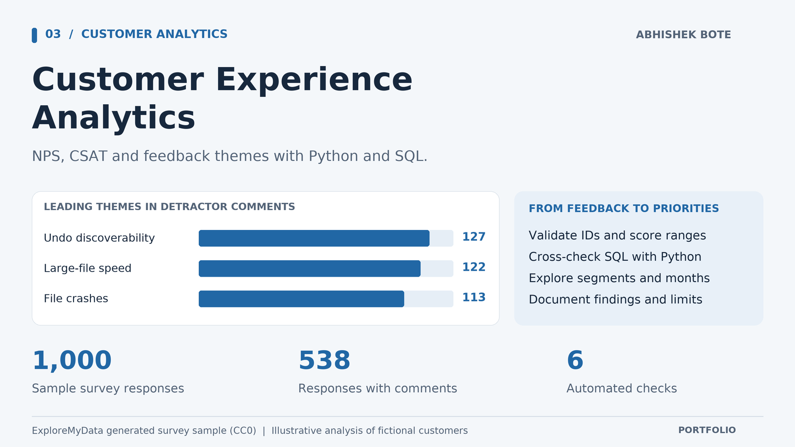

# Customer Experience Analytics: NPS and CSAT



Built by [Abhishek Bote](https://github.com/InfinityAbhi).

This is a completed, reproducible portfolio analysis of **1,000 generated sample survey responses**. It validates recommendation and satisfaction scores, computes NPS and top-two-box CSAT with SQL and Python, compares segments and months, classifies recurring detractor comments, and produces a local interactive dashboard.

The dataset is [ExploreMyData's CC0 survey response sample](https://exploremydata.com/datasets/survey-responses). No respondent is real. The CSV is stored in `data/survey-responses-1000.csv`, with its SHA-256 in `output/metrics.json`. The source deliberately reuses a small phrase pool and generates satisfaction scores correlated with NPS; all findings are illustrative, not company results.

Run the analysis with Python 3.10 or newer:

```sh
python3 run_analysis.py
python3 -m unittest -v
```

The analysis uses the Python standard library, with no external package installation required. Six automated checks cover score boundaries, valid source data, duplicate IDs, score-to-band mismatches, invalid satisfaction scores, and comment labeling.

Then open `output/dashboard.html` in a browser. It works offline and can filter by segment, region, and month. `output/overall.csv`, `segments.csv`, `themes.csv`, and `monthly.csv` are exported for spreadsheet or BI-tool review. The SQL definitions live in `analytics.sql`.

## Metric definitions

- **NPS:** 100 × (promoters minus detractors) / valid responses, where promoters scored 9-10 and detractors scored 0-6.
- **CSAT:** 100 × ratings of 4 or 5 / valid responses on the 1-5 satisfaction question.
- **Theme counts:** rule-based labels applied only to nonblank comments among detractors. Empty comments are never interpreted as positive or negative.

The pipeline stops on duplicate response IDs, invalid timestamps, out-of-range scores, missing segments/regions, and NPS score-to-band mismatches. It independently recomputes headline metrics in Python to check the SQL output. Filtered dashboard values are descriptive. The survey does not establish a causal effect or an improvement after an intervention.

## Verified findings on the sample

- 1,000 valid and unique responses; zero NPS score-to-band mismatches.
- NPS: -63.6; top-two-box CSAT: 15.1%. These describe only the generated sample.
- 538 responses include optional comments. Among detractor comments, the leading recurring themes are undo discoverability (127), large-file speed (122), and file crashes (113).
- Enterprise respondents have the lowest segment NPS (-70.7, 150 responses). This is an illustrative comparison, not proof that enterprise users are more dissatisfied in an actual product.

An example action brief would prioritize the undo interaction, large-file loading, and crash reproduction in a user research or QA backlog, then test changes on real customers before making any outcome claim.
